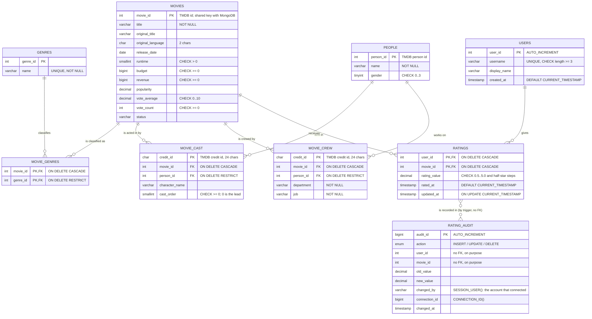

# Relational schema (MySQL `moviedb`)

The diagram below is written in Mermaid, which GitHub renders directly.
For the report, open this file on GitHub and screenshot it, or paste the
block into <https://mermaid.live> and export a PNG. The authoritative
version of everything here is `database/mysql/01_schema.sql`.

## Relationships, and why each one is shaped that way

| Relationship | Cardinality | How it is implemented |
|---|---|---|
| movie — genre | **many-to-many** | `movie_genres`, a junction table whose primary key is the pair `(movie_id, genre_id)`. The composite key is the constraint: it makes attaching the same genre twice impossible. 12,160 rows. |
| movie — person (cast) | **many-to-many**, with attributes | `movie_cast` carries `character_name` and `cast_order`, which belong to the *relationship*, not to the film or the person. Keyed on TMDB's `credit_id`, not on `(movie_id, person_id)`, because one person can hold two credits on the same film (two roles). 106,257 rows. |
| movie — person (crew) | **many-to-many**, with attributes | `movie_crew`, same reasoning, carrying `department` and `job`. 129,581 rows. |
| user — movie (rating) | **many-to-many**, with attributes | `ratings`, keyed on `(user_id, movie_id)`. Here the composite key *is* the business rule "one rating per user per film", so no surrogate key is used. |
| rating — audit | one-to-many, **no foreign key** | Written by the triggers in `08_triggers.sql`. An audit row must outlive the rating and the user it describes, so a foreign key would be actively wrong. |

Cast and crew are kept as two tables rather than one with a `role_type`
column: a cast credit has a character and a billing position, a crew
credit has a department and a job, and merging them would leave half
the columns NULL in every row.

## Constraints, by kind

| Kind | Where | Examples |
|---|---|---|
| Primary keys | all 9 tables | including 3 composite ones (`movie_genres`, `ratings`) |
| Foreign keys | 8 | `CASCADE` where the child is meaningless alone (a genre link, a credit, a rating), `RESTRICT` where losing the parent would lose information (a genre or a person still in use) |
| `UNIQUE` | 2 | `genres.name`, `users.username` |
| `CHECK` | 11 | ranges (`vote_average` 0–10), signs (`budget >= 0`), string length (`username`), and `rating_value * 2 = FLOOR(rating_value * 2)`, which enforces half-star steps |
| `NOT NULL` + types | throughout | `CHAR(2)` for a language code, `DECIMAL(2,1)` for a rating, `DATE` for a release date |
| Triggers | 5 | the audit trail, and the cross-table rule a `CHECK` cannot express: a rating may not point at a film that has not been released. See `08_triggers.sql` |
| Privileges | 3 accounts | `01b_create_user.sql`: the application may not run DDL and may not write the catalogue or the audit table; the reporting account sees only views |

## Normalisation

Every table is in BCNF. The two decisions worth defending in the report
are both recorded in `data/cleaned/cleaning_report.txt`:

- `credits.title` was dropped. It duplicated `movies.title` (verified
  identical across all 4,803 rows), and since the join is on
  `movie_id`, keeping it would have been a transitive dependency
  `credit_id → movie_id → title`.
- `gender` was moved out of the credit rows onto `people`. It depends
  on the person, not on the credit, so storing it per credit repeated
  it 106,257 times instead of 104,842.

## Views (`04_views.sql`)

| View | What it adds |
|---|---|
| `v_movie_stats` | per film: TMDB score, a Bayesian weighted score, and our users' average |
| `v_movie_cards` | one row per film with genres and directors flattened into lists, for the browse page |
| `v_top_rated_per_genre` | top 10 per genre, using `RANK() OVER (PARTITION BY ...)` |
| `v_genre_year_stats` | counts, scores and revenue per genre and year |
| `v_director_stats` | per-director totals |
| `v_user_activity` | rating activity per user, keeping users with none |

The views also carry the security design: the reporting account can read
them but has no privilege on the tables underneath.
