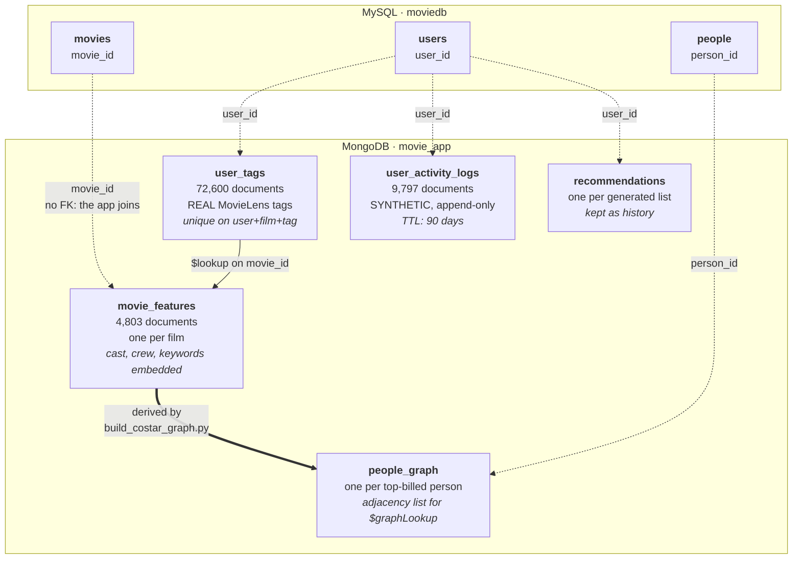

# Document schema (MongoDB `movie_app`)

Five collections. `database/mongodb/create_collections.py` is the
authoritative version; this file is the explanation that belongs in the
report.



The dotted lines are the keys the two databases share. They are
conventions, not constraints: MongoDB cannot check that `user_id` 7
exists in MySQL, so the application has to. That is the single biggest
difference between the two halves of this project.

---

## 1. `movie_features` — denormalised, on purpose

```javascript
{
  _id: ObjectId("..."),          // MongoDB's own key
  movie_id: 19995,               // = MySQL movies.movie_id (TMDB id), UNIQUE
  overview: "In the 22nd century, a paraplegic Marine ...",
  poster_path: "/kmcqlZGaSh20zpTbuBNS9b4mkay.jpg",
  keywords: [
    { id: 1463, name: "culture clash" },
    { id: 2964, name: "future" }
  ],
  cast: [                        // MySQL: movie_cast JOIN people
    { person_id: 65731, name: "Sam Worthington",
      character: "Jake Sully", order: 0 },
    ...                          // up to 100+ entries
  ],
  crew: [                        // MySQL: movie_crew JOIN people
    { person_id: 2710, name: "James Cameron",
      department: "Directing", job: "Director" },
    ...
  ],
  production_companies:  [ { company_id: 289, name: "Ingenious Film Partners" } ],
  production_countries:  [ { country_code: "US", name: "United States of America" } ],
  spoken_languages:      [ { language_code: "en", name: "English" } ]
}
```

**Design scheme: denormalisation** (lecture 8, scheme 2). This document
reverses the decomposition that `01_schema.sql` performs. Four MySQL
tables and two joins become one document and one `find_one`.

What that buys and what it costs:

| | MongoDB (embedded) | MySQL (normalised) |
|---|---|---|
| "Give me this film with everybody on it" | one document read | two 3-table joins |
| "Every film this actor is in" | multikey index on `cast.person_id` | index on `movie_cast.person_id` |
| "This person changed their name" | **every document holding them must be rewritten** | one row in `people` |
| Storage for the cast and crew data | larger: a name is stored once per credit | a name is stored once |

The third row is the update anomaly from lecture 4, and benchmark task
T4 measures it: `modified_count` is how many documents one rename
touched, against MySQL's constant 1.

---

## 2. `user_tags` — user-generated, real, needs uniqueness

72,600 of these are **real**: tag applications written by the same
1,500 MovieLens users who are in MySQL's `users` table. MovieLens
publishes `tags.csv`, so these are genuine free-text labels real people
put on real films, with their real timestamps (2005–2019).

```javascript
{
  _id: ObjectId("..."),
  user_id: 1,                    // = MySQL users.user_id
  movie_id: 19995,
  tag: "great visuals",          // 2-40 characters
  created_at: ISODate("2026-11-02T08:14:00Z"),
  updated_at: ISODate("2026-11-02T09:01:00Z")   // optional
}
```

The length limits are in the validator; "one user cannot put the same
tag on the same film twice" cannot be, so it is a **unique index** on
`(user_id, movie_id, tag)`. Uniqueness in MongoDB is always an index,
never part of the schema — and because MongoDB refuses to build a
unique index over data that already violates it, the import has to
deduplicate first.

The bounds, 1 to 100 characters, were set **from** the real data rather
than guessed: MovieLens tags run from 1 to 230 characters, and 100
keeps 99.994% of them while matching what `webapp/routes.py` already
truncates a typed tag to.

---

## 3. `user_activity_logs` — the reason this project uses a document store

**This collection is synthetic, and that is declared everywhere it
appears.** No public dataset contains page views or searches, so the
9,797 documents are generated from each user's own real ratings: films
they rated 4.0 or better become views, some of those views become
ratings, and a search precedes them. It is generated rather than left
empty because three features read it — the "most viewed films"
aggregation, the MongoDB-only recommender, and the activity feed on a
profile — and all three are dead without it.

Its timestamps are stored in the data file as `seconds_ago` and made
absolute at **import** time. That is not a shortcut: the TTL index
below has a 90-day window, so a file of fixed historical dates would be
deleted by MongoDB's TTL monitor within a minute of being loaded.

```javascript
// a search
{ user_id: 1, event_type: "search",
  timestamp: ISODate("..."),
  metadata: { query: "science fiction", result_count: 24, source: "browse" } }

// a film view
{ user_id: 1, event_type: "view_movie", movie_id: 19995,
  timestamp: ISODate("..."),
  metadata: { source: "search_results" } }

// a rating, written in MySQL but logged here
{ user_id: 1, event_type: "rate_movie", movie_id: 19995,
  timestamp: ISODate("..."),
  metadata: { rating: 4.5, source: "movie_page" } }
```

**Design scheme: built from scratch** (lecture 8, scheme 3). There is no
MySQL table that corresponds to this, and there should not be. `metadata`
has a different shape for every event type, and new event types arrive
whenever a feature is added. In MySQL that is either a wide table that
is mostly NULL, one table per event type, or a JSON column — all three
of which fight the relational model instead of using it.

What is still constrained: `event_type` must be one of the values in
`database/mongodb/event_types.py`, enforced by an `enum` in the
validator, because every aggregation groups by it and a typo would
silently create a new category. The same list is imported by the web
application, so the two cannot disagree.

A **TTL index** on `timestamp` expires these documents after 90 days.
MySQL has no equivalent; it needs a scheduled `DELETE` job.

---

## 4. `recommendations` — history, not a cache

```javascript
{
  _id: ObjectId("..."),
  user_id: 1,
  generated_at: ISODate("..."),
  algorithm: "hybrid_sql_keyword",         // or "keyword_similarity"
  based_on: {                              // explainability
    source: "MySQL ratings + MongoDB movie_features",
    min_rating: 4.0, liked_films: 12, profile_keywords: 143,
    favourite_genres: ["Science Fiction", "Thriller"], genre_boost: 1.15
  },
  recommendations: [
    { movie_id: 1726, score: 1.0,
      matched_keywords: ["future", "artificial intelligence"],
      reason: "Matches 7 keywords from films you rated 4.0+; also in your favourite genre" }
  ]
}
```

Lists are appended, never overwritten, so the two algorithms can be
compared over time. `score` is validated as a double between 0 and 1.

---

## 5. `people_graph` — derived, to make a graph traversal possible

```javascript
{
  person_id: 31,
  name: "Tom Hanks",
  film_count: 34,
  costar_ids: [ 1979, 2047, 6949, ... ],   // the adjacency list
  built_at: ISODate("...")
}
```

Built from `movie_features` by `build_costar_graph.py`, using only the
top 10 billed cast of each film (include everyone and the graph connects
almost everyone to almost everyone, which makes "degrees of separation"
meaningless).

This is the same facts stored a **third** time — they are in MySQL's
`movie_cast` and in the `cast` arrays already — in the one shape
`$graphLookup` can walk: `connectFromField: "costar_ids"` →
`connectToField: "person_id"`. The honest costs are extra storage and
staleness until the script is run again.

---

## Indexes (`create_indexes.py`)

| Collection | Index | Kind | Why |
|---|---|---|---|
| `movie_features` | `movie_id` | unique | one document per film; makes `movie_id` safe as the join key to MySQL |
| | `keywords.name` | **multikey** | keyword search on the Discover page |
| | `cast.person_id` | **multikey** | "every film this actor is in" — without it, a collection scan |
| | `crew.person_id` | **multikey** | the same for crew |
| | `overview` | **text** | full-text search; MongoDB allows only one text index per collection |
| `user_tags` | `(user_id, movie_id, tag)` | **unique** | the constraint a validator cannot express |
| | `movie_id`, `user_id`, `(user_id, movie_id)` | compound | the film page and the profile page |
| `user_activity_logs` | `(user_id, timestamp desc)` | compound | "this user's newest events", sorted by the index |
| | `timestamp` | **TTL 90 days** | automatic expiry |
| | `event_type`, `movie_id` | single | the aggregations |
| `recommendations` | `(user_id, generated_at desc)` | compound | "the newest list for this user" |
| | `(algorithm, generated_at desc)` | compound | comparing algorithms |
| `people_graph` | `person_id` | unique | `$graphLookup`'s `connectToField`; without it every hop is a scan |
| | `name`, `film_count` | single | the search box and the ranking |

**Multikey** is the index type with no MySQL counterpart: it indexes
every element of an embedded array, so one film with 80 cast members
produces 80 index entries. `benchmark/mongo_index_bench.py` measures
what it is worth.

---

## Side by side

| | MySQL | MongoDB |
|---|---|---|
| Unit | row in a table | document in a collection |
| Schema | `CREATE TABLE`, enforced always | `$jsonSchema` validator, opt-in |
| `NOT NULL` | `NOT NULL` | `required: [...]` |
| Ranges / lengths | `CHECK` | `minimum`/`maximum`, `minLength`/`maxLength` |
| Value lists | `CHECK ... IN` | `enum` |
| Uniqueness | `UNIQUE` constraint | unique **index** |
| Referential integrity | `FOREIGN KEY`, enforced | **nothing** — the application's job |
| Cross-table rules | triggers (`SIGNAL`) | application code |
| Joins | `JOIN`, any shape | `$lookup`, or avoided by embedding |
| Recursion | one self-join per hop, written in advance | `$graphLookup`, depth as a parameter |
| Many results at once | several queries, or `WITH ROLLUP` | `$facet`, one pass |
| Transactions | yes, across any tables | yes, but only on a replica set — ours is a single node, so no |
| Expiry | a scheduled job | TTL index |
